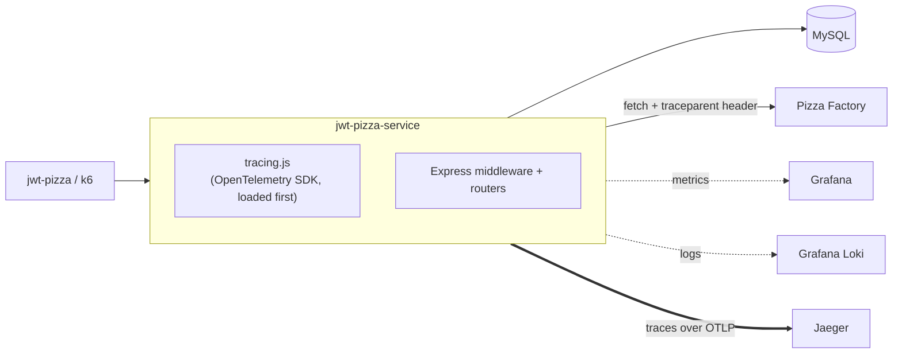
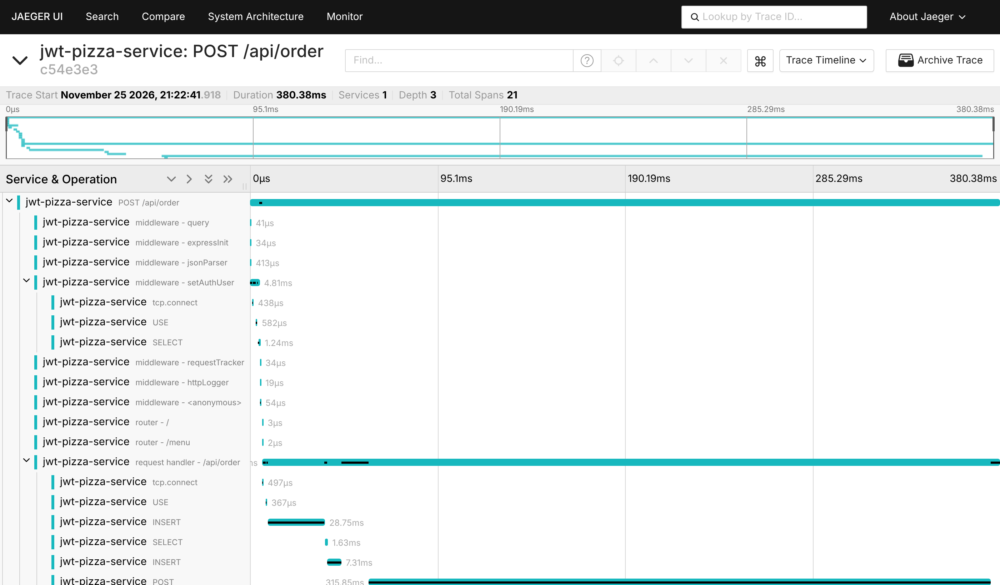
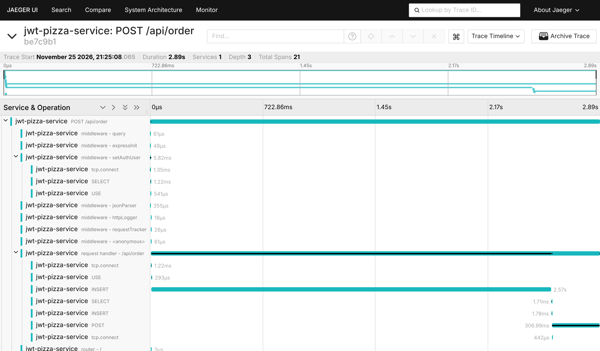

# Curiosity Report - Following a Pizza Order with OpenTelemetry Tracing

My topic is distributed tracing with OpenTelemetry, which I tried out on my own jwt-pizza-service.

Everything I used is in the [curiosityReport/](curiosityReport/) folder, including scripts, raw results and screenshots.

---

## 1. Why I was curious

I've seen tracing at work, and it's honestly kind of crazy how much you can see. When something goes wrong, we can literally tell everything that happened during a request. Every API call, how long each one took, and the error logs that go with it. In this class I built metrics and logging for jwt-pizza-service by hand, so I wanted to see if I could get that same kind of visibility in my own project.

I also feel like tracing matters even more now that we're in an age of AI where you can iterate really fast. When you're shipping that quickly, you need to know exactly what's happening. With tracing you can find what's wrong before a user even reports it, have an agent spin up and work on it, and get it fixed quickly.

There was one question my metrics and logs couldn't answer. **When an order is slow, which step is slow?** I wanted to find out if tracing could answer that, and how much it would slow things down.

### What OpenTelemetry is (short version)

OpenTelemetry ("OTel") is an open standard and a set of libraries for collecting **metrics, logs and traces** from your app. You add it once and you can send the data anywhere that speaks its protocol (OTLP), like Jaeger, Grafana Tempo or Datadog. So you're not stuck with one vendor.

We already did metrics and logs in class. This report is about the third one, **traces**. A trace follows *one* request through every step it takes. Each step is called a **span**, and it has a start time and a duration. Spans nest under whatever step caused them.



Here's the gap I had before this. metrics.pizzaPurchase() just records one total "factory latency" number. It can't tell me *which* order was slow, or *which step* inside that order was slow.

---

## 2. How I researched it

| Source | What it says | How I used it |
|---|---|---|
| [What is OpenTelemetry?](https://opentelemetry.io/docs/what-is-opentelemetry/) (opentelemetry.io) | OTel works with any vendor. There's an API (what your code calls) and an SDK (what actually collects and sends the data), and data goes out over OTLP. | I sent my traces over OTLP to Jaeger running locally. I could point the same setup at Grafana Tempo later without changing the app. |
| [OpenTelemetry Node.js getting started](https://opentelemetry.io/docs/languages/js/getting-started/nodejs/) | You install the Node SDK and the auto-instrumentations, then load the SDK *before* your app code so it can wrap libraries like Express as they load. | This is how I wrote tracing.js (about 10 lines) and started the service with node --require ./tracing.js. It's why Experiment 1 didn't need any changes to my app code. |
| [OpenTelemetry sampling docs](https://opentelemetry.io/docs/concepts/sampling/) | Head sampling decides right when a trace starts whether to keep it. The traceidratio sampler keeps a set percentage, and you can turn it on with environment variables. | I ran the 10% sampling tests in Experiments 3 and 4 with just environment variables. It also helped me understand why the traces it skips still cost CPU. |
| [W3C Trace Context](https://www.w3.org/TR/trace-context/) | This is the standard for the traceparent header. It has four parts, which are the version, trace ID, parent span ID and flags. The last part tells you if the trace is being recorded. | I used it to decode the header my fake factory got, then checked the recorded flag against Jaeger for 30 orders in Experiment 4. |
| [Dapper, a Large-Scale Distributed Systems Tracing Infrastructure](https://research.google/pubs/dapper-a-large-scale-distributed-systems-tracing-infrastructure/) (Google, 2010) | Google traced requests across all its services as trees of spans. They put the tracing code inside shared libraries so developers didn't have to change anything, and they sampled heavily to keep it cheap. | This gave me the history for the State of the Art section. Their "put it in the shared libraries" idea is basically what auto-instrumentation did in Experiment 1, and their focus on cost matched what I saw in Experiment 3. |
| [OpenTelemetry at the CNCF](https://www.cncf.io/projects/opentelemetry/) | OpenTelemetry started in 2019 when OpenTracing and OpenCensus merged. It's hosted by the Cloud Native Computing Foundation. | I used it for the history in the State of the Art section. |
| [Jaeger documentation](https://www.jaegertracing.io/docs/) | The all-in-one image runs Jaeger's collector, in-memory storage and UI in one container, and it takes OTLP on port 4318. | I ran Jaeger in Docker for every experiment. I also used the same HTTP API its UI uses (/api/traces) to pull trace data in Experiments 2 and 4. |
| [Grafana k6 documentation](https://grafana.com/docs/k6/latest/) | k6 runs load tests from a JavaScript file. You can set the number of virtual users and the duration, and export a JSON summary. | I used it to write the stress test for Experiment 3 (20 users, 30 seconds, no pauses) and save each run as JSON. |
| [MySQL LOCK TABLES](https://dev.mysql.com/doc/refman/8.0/en/lock-tables.html) | If one session holds a WRITE lock on a table, everyone else has to wait until it's released. | I used this to make a realistic database slowdown in Experiment 2, Part B. |

On top of reading, I tested everything myself against my own service in the experiments below.

---

## 3. State of the art

- **In 2010, Google published the Dapper paper.** They traced every request across thousands of services and used sampling to keep the cost low. Pretty much every modern tracing tool comes from this idea.
- **In 2012, Twitter open-sourced Zipkin**, and then **Uber released Jaeger** in 2017. The problem was each one had its own APIs and formats, so switching tools meant rewriting your code.
- **Between 2016 and 2018, two competing standards** showed up, OpenTracing (a CNCF project) and OpenCensus (from Google).
- **In 2019, they merged into OpenTelemetry**, which is now hosted by the Cloud Native Computing Foundation (CNCF). The CNCF says it's one of their most active projects, right behind Kubernetes.
- **In 2020, W3C Trace Context became an official W3C Recommendation.** Now any service in any language can pass a trace along with the same traceparent header.
- **Today**, the tracing, metrics and logs specs are all stable. Most big observability tools take OTLP directly, like Grafana Tempo, Datadog, Honeycomb, New Relic and AWS. Jaeger v2 is even built on top of the OpenTelemetry Collector. What people are still figuring out is mostly **cost**, like how much to sample, and "tail sampling" (deciding which traces to keep *after* you know if they were slow or failed).

---

## 4. Experiments

### Setup (used for all four experiments)

**My environment.** I used Linux with 4 CPUs, Node 22.23.5, Docker 29.9.3, MySQL 8.0, Jaeger 1.62.0 and k6 0.54.0. The OpenTelemetry packages were @opentelemetry/sdk-node 0.301.2, @opentelemetry/auto-instrumentations-node 0.83.1 and @opentelemetry/exporter-trace-otlp-http 0.301.2.

**Step 1. Start MySQL and Jaeger.**

```bash
docker run -d --name pizzaDb -e MYSQL_ROOT_PASSWORD=tempdbpassword -p 3306:3306 mysql:8.0
docker run -d --name jaeger -e COLLECTOR_OTLP_ENABLED=true -p 16686:16686 -p 4318:4318 jaegertracing/all-in-one:1.62.0
```

The Jaeger UI is at http://localhost:16686. Port 4318 is where the traces come in.

**Step 2. Add OpenTelemetry to jwt-pizza-service.**

```bash
cd jwt-pizza-service
npm install @opentelemetry/sdk-node @opentelemetry/auto-instrumentations-node @opentelemetry/exporter-trace-otlp-http
cp ../jwt-pizza/curiosityReport/tracing.js src/tracing.js
```

[tracing.js](curiosityReport/tracing.js) is the only new code.

```js
const { NodeSDK } = require('@opentelemetry/sdk-node');
const { getNodeAutoInstrumentations } = require('@opentelemetry/auto-instrumentations-node');
const { OTLPTraceExporter } = require('@opentelemetry/exporter-trace-otlp-http');

const traceExporter = new OTLPTraceExporter({ url: 'http://localhost:4318/v1/traces' });

const sdk = new NodeSDK({
  serviceName: 'jwt-pizza-service',
  traceExporter,
  instrumentations: [getNodeAutoInstrumentations()],
});

sdk.start();
```

**Step 3. Point the service at local fakes.** I made two small fake servers.
- [fakeFactory.cjs](curiosityReport/fakeFactory.cjs) stands in for the pizza factory. It prints the traceparent header it gets and waits FACTORY_DELAY_MS before answering, so I can make it slow on purpose.
- [fakeGrafana.cjs](curiosityReport/fakeGrafana.cjs) stands in for Grafana. It prints the order metrics my metrics.js sends every 10 seconds.

Here's my src/config.js.

```js
module.exports = {
  jwtSecret: 'localsecret',
  db: {
    connection: { host: '127.0.0.1', user: 'root', password: 'tempdbpassword', database: 'pizza', connectTimeout: 60000 },
    listPerPage: 10,
  },
  factory: { url: 'http://localhost:4000', apiKey: 'fakekey' },
  metrics: { source: 'jwt-pizza-service', endpointUrl: 'http://localhost:4100', accountId: 'local', apiKey: 'local' },
};
```

**Step 4. Start everything** (each command in its own terminal).

```bash
FACTORY_DELAY_MS=300 node jwt-pizza/curiosityReport/fakeFactory.cjs
```

```bash
node jwt-pizza/curiosityReport/fakeGrafana.cjs
```

```bash
cd jwt-pizza-service/src && node --require ./tracing.js index.js 3000
```

**Step 5. Make a menu item, franchise and store, and save a login token.**

```bash
token=$(curl -s -X PUT localhost:3000/api/auth -H 'Content-Type: application/json' -d '{"email":"a@jwt.com","password":"admin"}' | node -pe 'JSON.parse(require("fs").readFileSync(0)).token')
curl -s -X PUT localhost:3000/api/order/menu -H 'Content-Type: application/json' -H "Authorization: Bearer $token" -d '{"title":"Veggie","description":"A garden of delight","image":"pizza1.png","price":0.0038}'
curl -s -X POST localhost:3000/api/franchise -H 'Content-Type: application/json' -H "Authorization: Bearer $token" -d '{"name":"pizzaPocket","admins":[{"email":"a@jwt.com"}]}'
curl -s -X POST localhost:3000/api/franchise/1/store -H 'Content-Type: application/json' -H "Authorization: Bearer $token" -d '{"name":"SLC"}'
```

This is how I placed an order in every experiment (the body is in [order.json](curiosityReport/order.json)).

```bash
curl -s -X POST localhost:3000/api/order -H 'Content-Type: application/json' -H "Authorization: Bearer $token" -d @jwt-pizza/curiosityReport/order.json
```

---

### Experiment 1. How much do you get without changing any code?

**Question.** If I only add tracing.js and don't touch my app code at all, what does one pizza order look like?

**Steps.** Do the setup above, place one order, then open Jaeger, pick jwt-pizza-service, and click **Find Traces**.

**Results** (trace c54e3e3a…)



| Measure | Value |
|---|---|
| Spans in one order | **21** |
| Lines of app code I changed | **0** |
| Libraries traced automatically | 5 of them, http, express, mysql2, undici (Node's fetch) and net |
| Whole request | 380.4 ms |
| Factory call | 315.8 ms (**83%** of the request) |
| First INSERT | 28.7 ms; the other MySQL calls took 0.4–7.3 ms |

**What stood out to me**
- The trace showed that setAuthUser runs a database SELECT on **every** request, before my route even starts. I didn't notice that just from reading my own code.
- My fake factory got a traceparent header that I never wrote any code to send. That's what made me want to do Experiment 4.

---

### Experiment 2. Metrics vs. traces, which one finds the slow step?

**My prediction.** Traces would find the problem faster.

**Part A, slow factory.** I restarted the fake factory with FACTORY_DELAY_MS=3000, placed 3 orders, and waited 10 seconds for a metrics report.

| What my metrics reported (3 orders) | Per order |
|---|---|
| http_latency for POST /api/order, 9,084 ms total | 3,028 ms |
| pizza_latency (factory only), 9,050 ms total | 3,017 ms |

The factory was 99.6% of the order time, so my metrics pointed right at it. The traces said the same thing. The factory POST took 3,003–3,020 ms of each 3,023–3,057 ms order. **So both found it just as well.** But that's only because I had already built a pizza_latency metric for exactly this case.

**Part B, slow database.** I set the factory back to 300 ms. Then in a second MySQL session I held a write lock on the orders table for 3 seconds, and placed an order while it was locked.

```bash
docker exec pizzaDb mysql -uroot -ptempdbpassword pizza -e "LOCK TABLES dinerOrder WRITE; SELECT SLEEP(3); UNLOCK TABLES;" &
sleep 0.5
curl -s -X POST localhost:3000/api/order -H 'Content-Type: application/json' -H "Authorization: Bearer $token" -d @jwt-pizza/curiosityReport/order.json
```

| | Metrics (change since last report) | Trace be7c9b1b… |
|---|---|---|
| Was the order slow? | Yes, 2,884 ms | Yes, 2,891 ms |
| Was it the factory? | No, 308 ms | No, 307 ms |
| Then what was it? | **2,576 ms unexplained** | **INSERT INTO dinerOrder … took 2,568 ms** |



**Result.** I was half right. Metrics can only answer the questions I thought of ahead of time. The trace answered a question I never planned for, and it told me the exact SQL statement.

---

### Experiment 3. How much does tracing slow things down?

**My prediction.** Less than 5% slower.

**Steps.** [tracingCost.js](curiosityReport/tracingCost.js) is a k6 stress test. It runs 20 virtual users for 30 seconds, each one looping "get menu, place order" with no pauses. I set the fake factory to FACTORY_DELAY_MS=0 so I'm only measuring my service's own work. [runTracingCost.sh](curiosityReport/runTracingCost.sh) restarts the service in three modes and runs the test twice for each one.

```bash
SERVICE_DIR=$PWD/jwt-pizza-service/src ./jwt-pizza/curiosityReport/runTracingCost.sh
```

10% sampling just uses OpenTelemetry's standard environment variables, with no code change.

```bash
OTEL_TRACES_SAMPLER=traceidratio OTEL_TRACES_SAMPLER_ARG=0.1 node --require ./tracing.js index.js 3000
```

**Results** ([raw output](curiosityReport/experiment3-results.txt))

| Setup | Requests/sec (run 1, run 2) | Avg latency | p95 latency | vs. no tracing |
|---|---|---|---|---|
| No tracing | **380** (386, 374) | 52.3 ms | 75.3 ms | baseline |
| 100% sampling | **298** (295, 300) | 66.9 ms | 97.2 ms | −22% throughput, +29% p95 |
| 10% sampling | **321** (317, 325) | 62.0 ms | 88.9 ms | −16% throughput, +18% p95 |

My two baseline runs were only about 3% apart, so these gaps are real and not just noise. No requests failed.

**Result.** I was wrong on this one. The thing that surprised me most was that **keeping only 10% of the traces still cost 16%**. It turns out sampling only skips *sending* the trace. The tracing code still wraps Express, mysql2 and fetch on every single request, and Experiment 4 proves it.

**This was a worst case on purpose, though.**
- The factory answered instantly, so the extra ~15 ms per request looks big next to everything else. On a normal 380 ms order like in Experiment 1, I estimate it'd be more like 4%. (That's an estimate, I didn't measure it.)
- MySQL, Jaeger, k6 and my service were all sharing the same 4 CPUs, so my service was fighting Jaeger for CPU.

---

### Experiment 4. How does a trace get passed between services?

**Question.** What is that traceparent header my fake factory got, and does it match what Jaeger records?

```
traceparent: 00 - c54e3e3aee110b5df756b3b843ffceb5 - 3dc22cbf41a98f67 - 01
             │    │                                  │                  │
             │    trace ID = the whole order         parent span ID =   flags
             │    (matches the Jaeger trace)         the step that      01 = recorded
             version                                 made this call     00 = not recorded
```

**Steps.** I started the service with 10% sampling and the factory at FACTORY_DELAY_MS=0, placed 30 orders, saved the headers the factory printed, and then checked each one against Jaeger with [checkHeaders.cjs](curiosityReport/checkHeaders.cjs).

```bash
for n in $(seq 1 30); do curl -s -o /dev/null -X POST localhost:3000/api/order -H 'Content-Type: application/json' -H "Authorization: Bearer $token" -d @jwt-pizza/curiosityReport/order.json; done
# copy the traceparent values from the fake factory's output into headers.txt, one per line
node jwt-pizza/curiosityReport/checkHeaders.cjs headers.txt
```

**Results** ([raw output](curiosityReport/experiment4-results.txt))

| Flag in header | Orders | Found in Jaeger |
|---|---|---|
| 01 | 6 | **6 of 6** |
| 00 | 24 | **0 of 24** |

- The version was 00 on all 30 orders.
- In all 6 recorded traces, the parent span ID matched the span for the fetch call (POST) to the factory. That's how a service further down the line can hang its own steps under the step that called it.
- I got 6 recorded orders instead of the 3 I expected. Each order is its own 10% chance, so with only 30 orders that's normal.
- **All 24 orders that weren't recorded still got a real trace ID and header.** That's why 10% sampling still cost 16% in Experiment 3.

---

## 5. What I learned

Overall, tracing works really well, and it was a lot easier to add than I thought it would be.

1. **Auto-instrumentation does most of the work for you.** One small file gave me 21 spans per order across Express, MySQL and fetch, and I didn't touch my app code. It even showed me something about my own service I didn't know. setAuthUser hits the database on every request.
2. **Traces answer questions you didn't plan for.** I thought traces would beat metrics, and I was only half right. My metrics found the slow factory just as fast, because I had built pizza_latency for exactly that. But when the database was the problem, my metrics could only say "2,576 ms went somewhere." The trace told me the exact INSERT statement.
3. **Tracing isn't free, but in real use it's pretty small.** On a normal order that spends most of its time waiting on the factory, the extra ~15 ms comes out to about 4% (my estimate). In my worst-case stress test it cut throughput by 22%. I also learned that dropping to 10% sampling only brought that down to 16%, because the tracing code still runs on every request. Sampling mostly saves you on sending and storing traces.
4. **The traceparent header is what makes it "distributed."** Any service that reads that one header can join the same trace, no matter what language it's written in.

This connects back to why I got curious in the first place. A trace like the one in Experiment 2 is exactly what you'd want to hand to an AI agent. It doesn't just say "orders are slow," it says "this SQL statement waited 2.5 seconds." That's specific enough to start fixing right away.

**What I'd do next.** I'd send traces from my deployed service to Grafana Tempo with 10% sampling, link each trace to its Loki logs using the trace ID, and look into tail sampling so every slow or failed order gets kept even when most traces are dropped.

### Summary of results

| # | Question | Answer |
|---|---|---|
| 1 | How much do you get for free? | 21 spans, 5 libraries, 0 lines of app code changed |
| 2 | Metrics or traces to find the slow step? | Same for problems I planned for; only traces caught the database lock |
| 3 | How much does tracing slow things down? | −22% throughput at 100% sampling, −16% at 10% (worst case) |
| 4 | How does a trace get passed between services? | The W3C traceparent header; its recorded flag matched Jaeger 30 out of 30 times |
